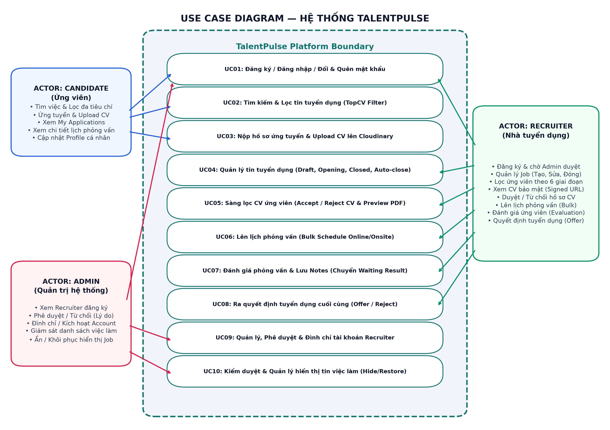
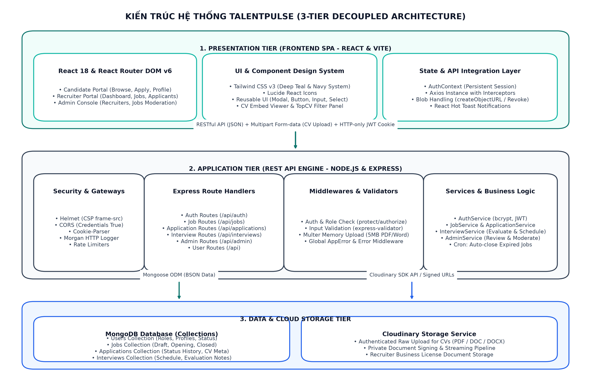
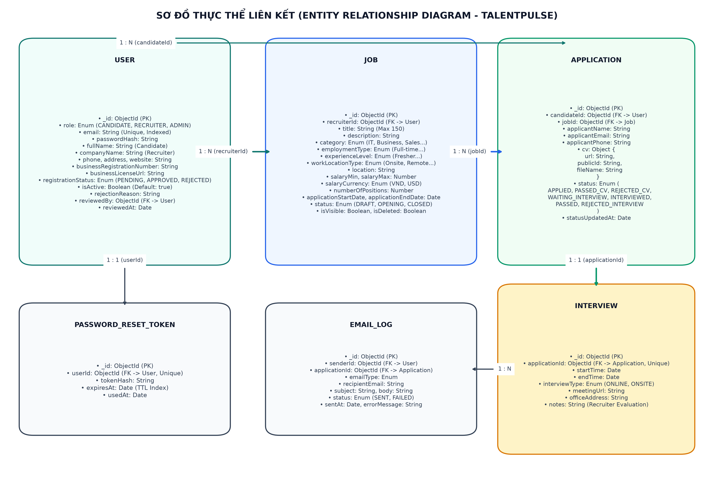
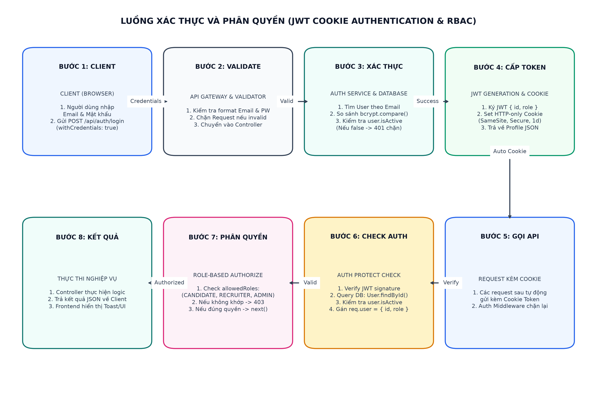
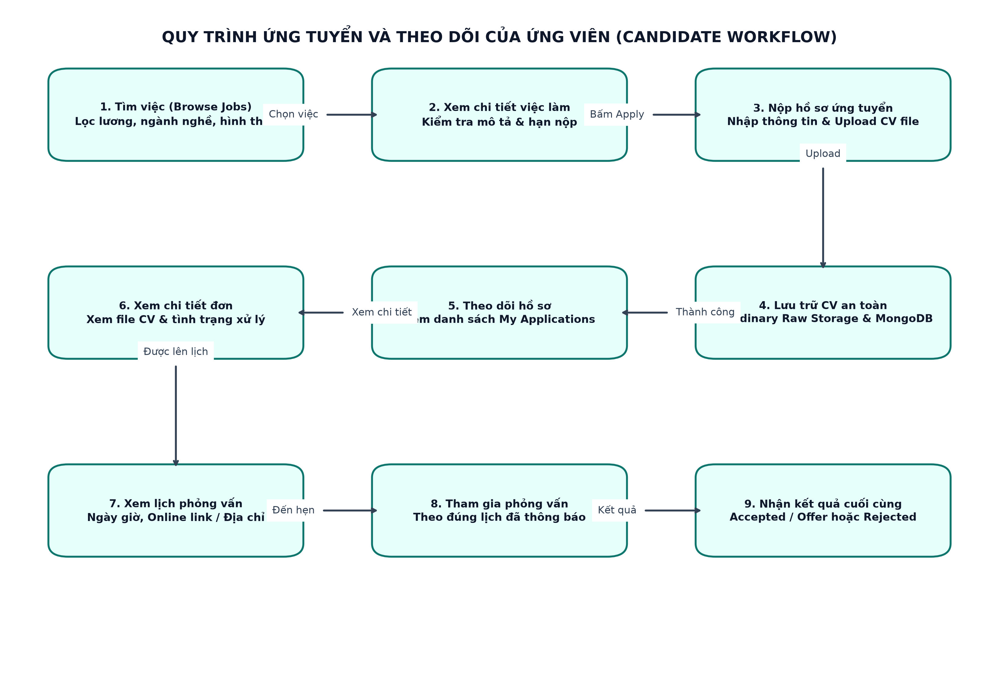
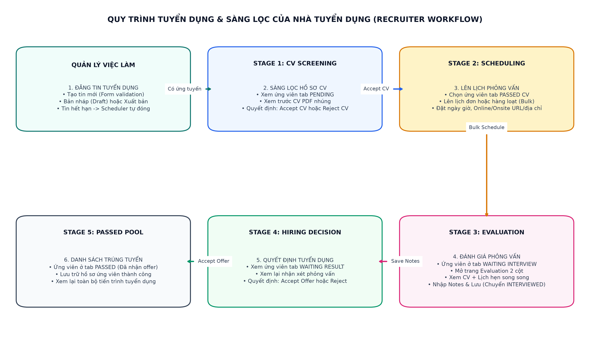

# TRƯỜNG ĐẠI HỌC FPT – FPT UNIVERSITY
## BỘ MÔN KỸ THUẬT PHẦN MỀM & HỆ THỐNG THÔNG TIN
### BÁO CÁO DỰ ÁN HỌC PHẦN: SDN392 – CLOUD-BASED SYSTEM DEVELOPMENT

---

# TALENTPULSE: CANDIDATE & RECRUITMENT MANAGEMENT SYSTEM
### Hệ thống Quản trị Tuyển dụng và Quản lý Ứng viên Trực tuyến trên Nền tảng Đám mây

**Thông tin học thuật & Đồ án:**
- **Môn học:** SDN392 – Cloud-Based System Development
- **Học kỳ:** Fall 2026 (Semester 7)
- **Cơ sở đào tạo:** Trường Đại học FPT (FPT University - Hòa Lạc Campus)
- **Sinh viên thực hiện:** HE194481
- **Chuyên ngành:** Kỹ thuật Phần mềm (Software Engineering)
- **Thời gian hoàn thành:** Tháng 11 / 2026

---

## LỜI MỞ ĐẦU & TÓM TẮT DỰ ÁN (EXECUTIVE SUMMARY)

Trong kỷ nguyên số hóa và sự bùng nổ của thị trường lao động công nghệ cao, quy trình tuyển dụng nhân sự đóng vai trò then chốt đối với năng lực cạnh tranh của mọi doanh nghiệp. Tuy nhiên, các phương thức quản lý hồ sơ ứng viên truyền thống qua email hoặc bảng tính (spreadsheets) đang bộc lộ những hạn chế nghiêm trọng: thất lạc thông tin, phân loại CV thủ công kém hiệu quả, chậm trễ trong việc phản hồi ứng viên và thiếu một bức tranh tổng thể về phễu tuyển dụng (recruitment pipeline).

Đồ án môn học **SDN392 – Cloud-Based System Development** với đề tài **TalentPulse** giải quyết trọn vẹn bài toán trên thông qua việc xây dựng một hệ thống Quản lý Tuyển dụng & Ứng viên chuyên nghiệp, hiện đại, hoạt động trên mô hình Client-Server tách biệt (Decoupled SPA & RESTful API) và sẵn sàng tích hợp các dịch vụ đám mây (Cloud Services) như MongoDB Atlas, Cloudinary Media Storage và Gmail SMTP Service.

Dự án được hoàn thành với các tiêu chí chất lượng kỹ thuật cao:
1. **Kiến trúc phân tầng chuẩn mực:** Phía máy chủ tổ chức theo mô hình Controller - Service - Model - Middleware với Express 5.x và Mongoose 9.x.
2. **Bảo mật đa lớp:** Xác thực JWT qua HTTP-only Cookie chống XSS, kiểm soát truy cập theo vai trò (Role-Based Access Control - RBAC), kiểm tra kích thước và loại tệp (MIME type / Magic bytes) ngăn ngừa tấn công tải file độc hại.
3. **Quy trình tuyển dụng chuyên sâu 6 giai đoạn:** Hỗ trợ nhà tuyển dụng quản lý ứng viên qua các phễu trạng thái chuẩn mực, lên lịch phỏng vấn linh hoạt (Online/Onsite) và đánh giá ứng viên hai cột trực quan.
4. **Trải nghiệm ứng viên tối ưu:** Tích hợp bộ lọc việc làm linh hoạt theo phong cách TopCV, xem trước (preview) và tải CV an toàn không rò rỉ thông tin cá nhân.

---

## MỤC LỤC TỔNG HỢP (TABLE OF CONTENTS)

- [Chương 1: Tổng quan dự án (Project Overview)](#chương-1-tổng-quan-dự-án-project-overview)
  - [1.1 Giới thiệu bài toán và bối cảnh](#11-giới-thiệu-bài-toán-và-bối-cảnh)
  - [1.2 Mục tiêu của hệ thống](#12-mục-tiêu-của-hệ-thống)
  - [1.3 Phân loại các nhóm người dùng (Target Users & Roles)](#13-phân-loại-các-nhóm-người-dùng-target-users--roles)
  - [1.4 Phạm vi hệ thống (System Scope)](#14-phạm-vi-hệ-thống-system-scope)
- [Chương 2: Phân tích yêu cầu hệ thống (Requirements Analysis)](#chương-2-phân-tích-yêu-cầu-hệ-thống-requirements-analysis)
  - [2.1 Yêu cầu chức năng (Functional Requirements)](#21-yêu-cầu-chức-năng-functional-requirements)
  - [2.2 Sơ đồ Use Case tổng quát](#22-sơ-đồ-use-case-tổng-quát)
  - [2.3 Bảng đặc tả Use Case chi tiết](#23-bảng-đặc-tả-use-case-chi-tiết)
  - [2.4 Yêu cầu phi chức năng (Non-Functional Requirements)](#24-yêu-cầu-phi-chức-năng-non-functional-requirements)
- [Chương 3: Thiết kế kiến trúc hệ thống (System Architecture Design)](#chương-3-thiết-kế-kiến-trúc-hệ-thống-system-architecture-design)
  - [3.1 Mô hình kiến trúc 3 tầng (Three-Tier Client-Server Architecture)](#31-mô-hình-kiến-trúc-3-tầng-three-tier-client-server-architecture)
  - [3.2 Thiết kế kiến trúc Backend (Backend Layered Architecture)](#32-thiết-kế-kiến-trúc-backend-backend-layered-architecture)
  - [3.3 Thiết kế kiến trúc Frontend (Frontend Architecture)](#33-thiết-kế-kiến-trúc-frontend-frontend-architecture)
  - [3.4 Tích hợp dịch vụ điện toán đám mây (Cloud Integration)](#34-tích-hợp-dịch-vụ-điện-toán-đám-mây-cloud-integration)
  - [3.5 Ngăn xếp công nghệ sử dụng (Technology Stack Summary)](#35-ngăn-xếp-công-nghệ-sử-dụng-technology-stack-summary)
- [Chương 4: Thiết kế cơ sở dữ liệu (Database Design & Schemas)](#chương-4-thiết-kế-cơ-sở-dữ-liệu-database-design--schemas)
  - [4.1 Sơ đồ quan hệ thực thể (Entity-Relationship Diagram - ERD)](#41-sơ-đồ-quan-hệ-thực-thể-entity-relationship-diagram---erd)
  - [4.2 Chi tiết các thực thể Mongoose Schema](#42-chi-tiết-các-thực-thể-mongoose-schema)
  - [4.3 Bảng quy ước Enums và giá trị trạng thái nghiệp vụ](#43-bảng-quy-ước-enums-và-giá-trị-trạng-thái-nghiệp-vụ)
  - [4.4 Chiến lược đánh chỉ mục (Database Indexing Strategy)](#44-chiến-lược-đánh-chỉ-mục-database-indexing-strategy)
- [Chương 5: Thiết kế giao diện lập trình ứng dụng (API Design & Implementation)](#chương-5-thiết-kế-giao-diện-lập-trình-ứng-dụng-api-design--implementation)
  - [5.1 Chuẩn thiết kế RESTful API và cấu trúc phản hồi](#51-chuẩn-thiết-kế-restful-api-và-cấu-trúc-phản-hồi)
  - [5.2 Danh mục API Endpoints chi tiết theo phân hệ](#52-danh-mục-api-endpoints-chi-tiết-theo-phân-hệ)
  - [5.3 Cấu trúc Request / Response chi tiết cho các nghiệp vụ chính](#53-cấu-trúc-request--response-chi-tiết-cho-các-nghiệp-vụ-chính)
- [Chương 6: Luồng nghiệp vụ hệ thống (Implemented Business Workflows)](#chương-6-luồng-nghiệp-vụ-hệ-thống-implemented-business-workflows)
  - [6.1 Luồng Xác thực và Phân quyền người dùng (Authentication & Authorization)](#61-luồng-xác-thực-và-phân-quyền-người-dùng-authentication--authorization)
  - [6.2 Luồng Tìm kiếm và Ứng tuyển của Ứng viên (Candidate Job Search & Apply)](#62-luồng-tìm-kiếm-và-ứng-tuyển-của-ứng-viên-candidate-job-search--apply)
  - [6.3 Luồng Tuyển dụng và Quản lý Ứng viên (Recruiter Hiring & Evaluation)](#63-luồng-tuyển-dụng-và-quản-lý-ứng-viên-recruiter-hiring--evaluation)
  - [6.4 Luồng Phê duyệt Doanh nghiệp và Điều phối của Quản trị viên (Admin Moderation)](#64-luồng-phê-duyệt-doanh-nghiệp-và-điều-phối-của-quản-trị-viên-admin-moderation)
  - [6.5 Luồng Tự động quét và Đóng việc làm hết hạn (Automated Cron Job Lifecycle)](#65-luồng-tự-động-quét-và-đóng-việc-làm-hết-hạn-automated-cron-job-lifecycle)
- [Chương 7: Thiết kế giao diện và Hướng dẫn người dùng (UI/UX & User Guide)](#chương-7-thiết-kế-giao-diện-và-hướng-dẫn-người-dùng-uiux--user-guide)
  - [7.1 Triết lý thiết kế UI/UX hiện đại](#71-triết-lý-thiết-kế-uiux-hiện-đại)
  - [7.2 Hướng dẫn người dùng cho Ứng viên (Candidate User Guide)](#72-hướng-dẫn-người-dùng-cho-ứng-viên-candidate-user-guide)
  - [7.3 Hướng dẫn người dùng cho Nhà tuyển dụng (Recruiter User Guide)](#73-hướng-dẫn-người-dùng-cho-nhà-tuyển-dụng-recruiter-user-guide)
  - [7.4 Hướng dẫn người dùng cho Quản trị viên (Admin User Guide)](#74-hướng-dẫn-người-dùng-cho-quản-trị-viên-admin-user-guide)
- [Chương 8: Kế hoạch và Kết quả kiểm thử (Testing & Quality Assurance)](#chương-8-kế-hoạch-và-kết-quả-kiểm-thử-testing--quality-assurance)
  - [8.1 Chiến lược kiểm thử hệ thống](#81-chiến-lược-kiểm-thử-hệ-thống)
  - [8.2 Bảng kịch bản kiểm thử chi tiết (15 Test Cases)](#82-bảng-kịch-bản-kiểm-thử-chi-tiết-15-test-cases)
  - [8.3 Đánh giá chất lượng và Độ tin cậy](#83-đánh-giá-chất-lượng-và-độ-tin-cậy)
- [Chương 9: Hướng dẫn cài đặt và Triển khai hệ thống (Installation & Deployment)](#chương-9-hướng-dẫn-cài-đặt-và-triển-khai-hệ-thống-installation--deployment)
  - [9.1 Yêu cầu môi trường tiền đề (Prerequisites)](#91-yêu-cầu-môi-trường-tiền-đề-prerequisites)
  - [9.2 Thiết lập biến môi trường (Environment Configuration)](#92-thiết-lập-biến-môi-trường-environment-configuration)
  - [9.3 Cài đặt và Khởi chạy Backend](#93-cài-đặt-và-khởi-chạy-backend)
  - [9.4 Cài đặt và Khởi chạy Frontend](#94-cài-đặt-và-khởi-chạy-frontend)
  - [9.5 Khởi tạo cơ sở dữ liệu MongoDB](#95-khởi-tạo-cơ-sở-dữ-liệu-mongodb)
  - [9.6 Các lưu ý triển khai môi trường Production](#96-các-lưu-ý-triển-khai-môi-trường-production)
- [Chương 10: Kết luận và Hướng phát triển (Conclusion & Future Work)](#chương-10-kết-luận-và-hướng-phát-triển-conclusion--future-work)
  - [10.1 Các kết quả nổi bật đã đạt được](#101-các-kết-quả-nổi-bật-đã-đạt-được)
  - [10.2 Hạn chế kỹ thuật hiện tại](#102-hạn-chế-kỹ-thuật-hiện-tại)
  - [10.3 Định hướng phát triển và Mở rộng tương lai](#103-định-hướng-phát-triển-và-mở-rộng-tương-lai)

---

## CHƯƠNG 1: TỔNG QUAN DỰ ÁN (PROJECT OVERVIEW)

### 1.1 Giới thiệu bài toán và bối cảnh
Trong thị trường tuyển dụng hiện đại, tốc độ và độ chính xác trong việc xử lý thông tin hồ sơ ứng viên quyết định trực tiếp tới khả năng thu hút nhân tài của doanh nghiệp. Các giải pháp thủ công như tiếp nhận hồ sơ qua hòm thư điện tử, lưu trữ CV trên máy tính cá nhân hoặc quản lý danh sách ứng viên qua các bảng tính Excel rời rạc dẫn tới các hạn chế nghiêm trọng:
- Hồ sơ bị phân tán, dễ thất lạc hoặc trùng lặp dữ liệu.
- Quá trình sàng lọc mất nhiều thời gian và thiếu tính nhất quán trong tiêu chí đánh giá.
- Không có cơ chế thông báo và phản hồi trạng thái tự động, khiến ứng viên rơi vào tình trạng chờ đợi vô vọng (hội chứng "Black hole" trong tuyển dụng).
- Nhà tuyển dụng khó khăn trong việc phối hợp nội bộ để sắp xếp lịch phỏng vấn và ghi nhận nhận xét đánh giá.

### 1.2 Mục tiêu của hệ thống
Hệ thống **TalentPulse** được nghiên cứu và xây dựng nhằm đạt được các mục tiêu trọng tâm:
1. Cung cấp nền tảng kết nối ứng viên và doanh nghiệp trực quan, nhanh chóng, minh bạch.
2. Số hóa toàn diện quy trình tuyển dụng từ khâu đăng tin, tiếp nhận hồ sơ, sàng lọc CV, tổ chức phỏng vấn cho đến ra quyết định tuyển dụng cuối cùng.
3. Hỗ trợ nhà tuyển dụng công cụ quản lý ứng viên tập trung theo phễu tuyển dụng 6 giai đoạn chuẩn mực.
4. Đảm bảo an toàn thông tin, quyền riêng tư của hồ sơ ứng viên và tài liệu doanh nghiệp.
5. Cung cấp giao diện quản trị cho phép Admin kiểm duyệt tính xác thực của doanh nghiệp và kiểm soát nội dung tin tuyển dụng trên toàn hệ thống.

### 1.3 Phân loại các nhóm người dùng (Target Users & Roles)
Hệ thống TalentPulse phân chia người dùng thành 3 nhóm đối tượng chính (Actors):
- **Ứng viên (Candidate):** Người tìm việc. Có thể duyệt danh sách việc làm công khai, lọc theo từ khóa, địa điểm, mức lương, kinh nghiệm; nộp hồ sơ ứng tuyển kèm CV (PDF/DOC/DOCX); theo dõi tiến độ hồ sơ cá nhân và nhận thư mời phỏng vấn.
- **Nhà tuyển dụng (Recruiter):** Đại diện các tổ chức, doanh nghiệp có nhu cầu nhân sự. Cần cung cấp mã số thuế (MST) và giấy phép đăng ký kinh doanh khi đăng ký; sau khi được phê duyệt, có quyền đăng tin, chỉnh sửa, đóng/mở tin tuyển dụng; sàng lọc hồ sơ ứng viên theo 6 giai đoạn; đặt lịch phỏng vấn (Online qua Google Meet / Zoom hoặc Trực tiếp tại văn phòng); và lưu trữ đánh giá phỏng vấn.
- **Quản trị viên hệ thống (Admin):** Đóng vai trò giám sát toàn bộ hoạt động của hệ thống; xét duyệt hoặc từ chối hồ sơ đăng ký của Recruiter; khóa hoặc kích hoạt tài khoản; ẩn hoặc hiện tin tuyển dụng vi phạm chính sách; và xem số liệu thống kê tổng thể.

### 1.4 Phạm vi hệ thống (System Scope)

| Phân hệ / Tính năng | Trạng thái triển khai | Ghi chú kỹ thuật |
|---|---|---|
| Xác thực JWT qua Cookie HTTP-only | ĐÃ HOÀN THÀNH | Bảo mật chống XSS, hỗ trợ Remember Me |
| Đăng ký / Đăng nhập Candidate & Recruiter | ĐÃ HOÀN THÀNH | Mã hóa mật khẩu bcrypt, kiểm tra MST |
| Phê duyệt tài khoản Recruiter bởi Admin | ĐÃ HOÀN THÀNH | Trạng thái PENDING, APPROVED, REJECTED |
| Đăng tin, sửa tin tuyển dụng | ĐÃ HOÀN THÀNH | Hỗ trợ Draft, Opening, Closed, validation lương |
| Tìm kiếm và Lọc việc làm TopCV | ĐÃ HOÀN THÀNH | Lọc đa tiêu chí: keyword, city, salary, level |
| Nộp hồ sơ ứng tuyển kèm tệp CV | ĐÃ HOÀN THÀNH | Lưu trữ Cloudinary, ràng buộc 1 ứng viên/1 job |
| Quy trình sàng lọc hồ sơ 6 tab | ĐÃ HOÀN THÀNH | All, Pending, Passed CV, Waiting Interview, Waiting Result, Passed |
| Đặt lịch phỏng vấn Online / Onsite | ĐÃ HOÀN THÀNH | Validate URL họp trực tuyến hoặc địa chỉ văn phòng |
| Đánh giá phỏng vấn và ra quyết định | ĐÃ HOÀN THÀNH | Lưu nhận xét chuyên môn, chuyển trạng thái Passed/Rejected |
| Xem trước (Preview) và Tải CV | ĐÃ HOÀN THÀNH | Proxy binary blob qua backend, an toàn Cloudinary |
| Tự động đóng việc làm hết hạn (Cron Job) | ĐÃ HOÀN THÀNH | node-cron quét định kỳ mỗi phút một lần |
| Gửi email thông báo tự động (Nodemailer) | HOÀN THÀNH SERVICE | Cấu hình qua biến môi trường SMTP Gmail |
| Thanh toán trực tuyến tin VIP (Payment) | CHƯA THỰC HIỆN | Nằm ngoài phạm vi yêu cầu đồ án môn học |
| AI trích xuất thông tin CV (AI Resume Parser) | CHƯA THỰC HIỆN | Định hướng phát triển trong tương lai |

---

## CHƯƠNG 2: PHÂN TÍCH YÊU CẦU HỆ THỐNG (REQUIREMENTS ANALYSIS)

### 2.1 Yêu cầu chức năng (Functional Requirements)
Hệ thống được tổ chức thành 4 phân hệ chức năng chính:
- **Phân hệ Xác thực & Phân quyền (Authentication & Authorization):**
  - Đăng ký tài khoản ứng viên (Candidate) và nhà tuyển dụng (Recruiter).
  - Đăng nhập xác thực với mật khẩu băm bcrypt và cấp phát JWT Token lưu trong HTTP-only Cookie.
  - Quản lý trạng thái phê duyệt nhà tuyển dụng (PENDING -> APPROVED / REJECTED).
  - Tự động chặn người dùng bị vô hiệu hóa (`isActive = false`).
- **Phân hệ Quản lý Việc làm (Job Management):**
  - Tạo mới và quản lý tin tuyển dụng với các trường thông tin đầy đủ.
  - Hỗ trợ lưu nháp (DRAFT), xuất bản công khai (OPENING) và đóng tin tuyển dụng (CLOSED).
  - Ràng buộc nghiệp vụ: Mức lương tối đa phải lớn hơn hoặc bằng mức lương tối thiểu; Ngày hết hạn phải sau ngày bắt đầu nhận hồ sơ.
  - Tìm kiếm toàn văn theo tiêu đề, tên công ty, yêu cầu kỹ năng và vị trí địa lý.
- **Phân hệ Ứng tuyển & Quản lý Hồ sơ (Application & Candidate Tracking):**
  - Tải lên CV định dạng PDF, DOC, DOCX dung lượng tối đa 10MB lên đám mây Cloudinary.
  - Ngăn chặn nộp đơn trùng lặp: Mỗi ứng viên chỉ được nộp một hồ sơ duy nhất cho mỗi bài đăng việc làm.
  - Quy trình quản lý trạng thái hồ sơ 6 tab đồng bộ giữa Frontend và Backend.
  - Đặt lịch phỏng vấn chuyên nghiệp hỗ trợ cả hai hình thức: Trực tuyến (Online Meeting) và Trực tiếp (Onsite Office).
  - Xem trước tài liệu CV dạng nhị phân an toàn trên giao diện và tải về với tên file gốc của ứng viên.
- **Phân hệ Quản trị Hệ thống (Admin Management):**
  - Xét duyệt hồ sơ pháp lý của doanh nghiệp (Mã số thuế, giấy phép kinh doanh).
  - Tạm khóa hoặc kích hoạt lại tài khoản người dùng trên toàn hệ thống.
  - Kiểm duyệt, ẩn tin tuyển dụng vi phạm chính sách hoặc phục hồi hiển thị.
  - Thống kê các chỉ số hoạt động tổng thể của nền tảng tuyển dụng.

### 2.2 Sơ đồ Use Case tổng quát
Dưới đây là sơ đồ Use Case thể hiện tương tác của 3 tác nhân chính (Candidate, Recruiter, Admin) với hệ thống TalentPulse:



*Hình 2.1: Sơ đồ Use Case tổng thể hệ thống TalentPulse*

### 2.3 Bảng đặc tả Use Case chi tiết

#### UC01: Đăng ký tài khoản Nhà tuyển dụng (Recruiter Registration)
- **Tác nhân chính:** Khách truy cập doanh nghiệp (Recruiter).
- **Tiền điều kiện:** Chưa đăng nhập vào hệ thống; email chưa từng được đăng ký trước đó.
- **Luồng sự kiện chính:**
  1. Người dùng chọn chức năng 'Đăng ký Nhà tuyển dụng' trên giao diện.
  2. Điền đầy đủ thông tin: Email, Mật khẩu, Họ tên, Tên công ty, Số điện thoại, Mã số thuế (MST) và đính kèm giấy phép kinh doanh.
  3. Hệ thống kiểm tra định dạng dữ liệu đầu vào (Validation).
  4. Backend mã hóa mật khẩu, tạo bản ghi User mới với `role = 'RECRUITER'` và `registrationStatus = 'PENDING'`.
  5. Hệ thống hiển thị thông báo tài khoản đang chờ Quản trị viên xét duyệt.
- **Hậu điều kiện:** Bản ghi User được lưu vào DB. Nhà tuyển dụng chưa thể đăng tin cho đến khi được Admin phê duyệt.

#### UC02: Nộp hồ sơ ứng tuyển công việc (Job Application Submission)
- **Tác nhân chính:** Ứng viên (Candidate).
- **Tiền điều kiện:** Đã đăng nhập vào tài khoản Candidate đang hoạt động; bài đăng việc làm ở trạng thái `OPENING`.
- **Luồng sự kiện chính:**
  1. Ứng viên xem chi tiết tin tuyển dụng và nhấn nút 'Ứng tuyển ngay'.
  2. Modal nộp hồ sơ mở ra, tự động điền họ tên, email và số điện thoại đã lưu.
  3. Ứng viên tải lên tệp hồ sơ cá nhân (CV định dạng PDF/DOC/DOCX dung lượng < 10MB).
  4. Backend kiểm tra xem ứng viên đã từng nộp hồ sơ vào công việc này hay chưa (Unique Compound Index).
  5. Hệ thống tải tệp CV lên đám mây Cloudinary và nhận URL an toàn cùng `publicId`.
  6. Bản ghi Application được khởi tạo với trạng thái `APPLIED`.
  7. Hệ thống hiển thị thông báo nộp đơn thành công và tự động đóng modal.
- **Hậu điều kiện:** Đơn ứng tuyển được ghi nhận, xuất hiện tại tab 'Chờ duyệt' (Pending) của Nhà tuyển dụng sở hữu việc làm.

#### UC03: Sàng lọc hồ sơ và Đặt lịch phỏng vấn (CV Screening & Schedule Interview)
- **Tác nhân chính:** Nhà tuyển dụng (Recruiter).
- **Tiền điều kiện:** Đã đăng nhập tài khoản Recruiter có trạng thái `APPROVED`; sở hữu công việc có hồ sơ nộp.
- **Luồng sự kiện chính:**
  1. Nhà tuyển dụng truy cập trang 'Quản lý việc làm' -> chọn danh sách 'Ứng viên'.
  2. Xem danh sách hồ sơ tại tab 'Chờ duyệt', mở xem trước tài liệu CV.
  3. Nhấn nút 'Duyệt CV' -> Hệ thống chuyển trạng thái hồ sơ thành `PASSED_CV`.
  4. Nhấn nút 'Lên lịch phỏng vấn' trên hồ sơ đã vượt qua vòng CV.
  5. Chọn hình thức phỏng vấn (Online hoặc Onsite), chọn thời gian diễn ra và điền thông tin đường dẫn cuộc họp (Google Meet) hoặc địa chỉ văn phòng.
  6. Backend khởi tạo bản ghi Interview liên kết với Application và cập nhật trạng thái hồ sơ thành `WAITING_INTERVIEW`.
  7. Nếu hệ thống email được kích hoạt, một thư mời tự động gửi tới email của ứng viên.
- **Hậu điều kiện:** Hồ sơ chuyển sang tab 'Chờ phỏng vấn' (Waiting Interview).

### 2.4 Yêu cầu phi chức năng (Non-Functional Requirements)
- **Hiệu năng (Performance):** Thời gian phản hồi trung bình của các API truy vấn danh sách dưới 200ms; trang chủ tải xong trong vòng 1.5 giây.
- **Bảo mật (Security):** Toàn bộ mật khẩu được băm một chiều với thuật toán bcrypt (Salt rounds = 10); Token JWT được lưu trữ nghiêm ngặt trong Cookie HTTP-only, chống lại tấn công đánh cắp mã độc qua XSS; áp dụng CORS chặt chẽ chỉ cho phép miền nguồn được ủy quyền truy cập.
- **Độ tin cậy & Toàn vẹn dữ liệu (Reliability & Integrity):** Sử dụng các ràng buộc khóa ngoại logic và chỉ mục duy nhất (Unique Compound Index) trong MongoDB để đảm bảo tính toàn vẹn, ngăn chặn việc tạo trùng lặp dữ liệu đơn ứng tuyển.
- **Khả năng sử dụng (Usability & Responsiveness):** Giao diện tương thích hoàn hảo trên các độ phân giải màn hình từ Desktop (1920x1080), Laptop (1366x768) đến Tablet và Smartphone. Thiết kế tuân thủ bảng màu chuẩn tuyển dụng SaaS chuyên nghiệp.

---

## CHƯƠNG 3: THIẾT KẾ KIẾN TRÚC HỆ THỐNG (SYSTEM ARCHITECTURE DESIGN)

### 3.1 Mô hình kiến trúc 3 tầng (Three-Tier Client-Server Architecture)
Hệ thống TalentPulse được thiết kế theo kiến trúc Client-Server tách rời hiện đại (Decoupled Architecture), phân tách độc lập giữa tầng giao diện người dùng (Presentation Layer), tầng xử lý nghiệp vụ (Business Logic Layer) và tầng dữ liệu lưu trữ (Data Storage Layer).



*Hình 3.1: Mô hình kiến trúc hệ thống 3 tầng của TalentPulse*

- **Presentation Layer (Frontend):** Ứng dụng Single Page Application (SPA) xây dựng trên nền tảng React 18 kết hợp Vite build tool, Tailwind CSS và Lucide Icons. Tầng này giao tiếp với máy chủ Backend hoàn toàn bất đồng bộ thông qua các yêu cầu RESTful HTTP/HTTPS sử dụng thư viện Axios.
- **Application Logic Layer (Backend):** Máy chủ Web REST API phát triển bằng Node.js 24 và framework Express 5.x. Chịu trách nhiệm xác thực, cấp quyền, kiểm duyệt dữ liệu đầu vào và thực thi toàn bộ quy tắc nghiệp vụ.
- **Data & Cloud Storage Layer:** Cơ sở dữ liệu tài liệu MongoDB lưu trữ toàn bộ dữ liệu có cấu trúc của hệ thống; kết hợp dịch vụ lưu trữ đám mây Cloudinary để lưu trữ an toàn các tệp tin CV và tài liệu pháp lý định dạng PDF/DOC/DOCX.

### 3.2 Thiết kế kiến trúc Backend (Backend Layered Architecture)
Phía máy chủ Backend được tổ chức nghiêm ngặt theo mô hình phân tầng hướng dịch vụ (Layered Service-Oriented Pattern), bao gồm các lớp thành phần sau:
- **Routes Layer:** Định nghĩa danh mục các API endpoints, ánh xạ URL với controller và gán các middleware bảo vệ (`auth.protect`, `auth.authorize`, `express-validator`).
- **Middlewares Layer:** Thực hiện các tác vụ tiền xử lý: Xác thực JWT từ cookie, kiểm tra quyền truy cập theo vai trò, bắt lỗi xác thực dữ liệu đầu vào (`validateRequest`), xử lý file tải lên (Multer) và bắt lỗi toàn cục (`errorHandler`).
- **Controllers Layer:** Tiếp nhận request từ client, trích xuất tham số (params, query, body), gọi các hàm xử lý tương ứng từ Service layer và định dạng phản hồi chuẩn JSON.
- **Services Layer:** Nơi chứa toàn bộ logic nghiệp vụ cốt lõi của ứng dụng (Business Logic). Các dịch vụ (`AuthService`, `JobService`, `ApplicationService`, `InterviewService`, `AdminService`) thực hiện tính toán, kiểm tra ràng buộc trạng thái và tương tác với cơ sở dữ liệu.
- **Models Layer:** Định nghĩa cấu trúc lược đồ Mongoose Schemas, các validation rules cấp cơ sở dữ liệu, các hàm pre-hooks và thiết lập indexes tối ưu truy vấn.
- **Schedulers Layer:** Tiến trình chạy nền độc lập quản lý bởi `node-cron` (`startJobScheduler`) thực hiện tự động cập nhật trạng thái các công việc đã hết hạn nộp hồ sơ.

Ví dụ thực tế về luồng xử lý một Request điển hình (`PATCH /api/jobs/:id/publish`):
```text
Client Request: PATCH /api/jobs/65b123.../publish (Kèm HTTP-only Cookie)
  │
  ├── 1. authMiddleware.protect: Trích xuất cookie 'token', verify JWT -> Query DB User.findById()
  │      -> Kiểm tra user.isActive === true (Nếu false -> throw AppError 401)
  │      -> Gán req.user = { id, role }
  │
  ├── 2. authMiddleware.authorize(ROLE.RECRUITER): Kiểm tra req.user.role === 'RECRUITER' (Nếu sai -> 403)
  │
  ├── 3. jobController.publishJob(req, res, next): Gọi jobService.publishJob(recruiterId, jobId)
  │
  ├── 4. jobService.publishJob:
  │      -> checkApprovedRecruiter: Kiểm tra Recruiter đã APPROVED và đang ACTIVE
  │      -> Tìm Job theo ID và recruiterId (Ràng buộc quyền sở hữu)
  │      -> Kiểm tra trạng thái hiện tại: Chỉ cho phép chuyển từ DRAFT sang OPENING
  │      -> Cập nhật job.status = JOB_STATUS.OPENING, lưu DB
  │
  └── 5. Controller trả về: HTTP 200 OK { success: true, message: 'Job published', data: { job } }
```

### 3.3 Thiết kế kiến trúc Frontend (Frontend Architecture)
Frontend được thiết kế theo hướng module hóa cao, đảm bảo tái sử dụng tối đa mã nguồn và phân tách rõ ràng trải nghiệm giữa các nhóm người dùng:
- **Cấu trúc thư mục phân tách theo chức năng:** `src/pages/` chia thành `auth/`, `candidate/`, `recruiter/`, `admin/`; `src/components/` chứa các component giao diện dùng chung; `src/services/` tập trung toàn bộ các hàm gọi API.
- **Kiến trúc Layouts & Protected Routes:** Sử dụng component `ProtectedRoute` bọc quanh các tuyến đường nhạy cảm. Nếu người dùng chưa đăng nhập hoặc không có vai trò hợp lệ, hệ thống tự động điều hướng về `/login` hoặc trang mặc định.
- **Quản lý trạng thái phiên làm việc (AuthContext):** Cung cấp hook `useAuth()` giúp toàn bộ cây component truy cập tức thời thông tin người dùng hiện tại, trạng thái phê duyệt và hàm đăng xuất.
- **Xử lý dữ liệu nhị phân (Blob Handling):** Khi xem trước hoặc tải CV, Axios nhận `responseType = 'blob'`. Frontend tạo Object URL bằng `URL.createObjectURL(blob)` và giải phóng bộ nhớ bằng `URL.revokeObjectURL()` khi đóng modal nhằm triệt tiêu rò rỉ bộ nhớ (memory leaks).

### 3.4 Tích hợp dịch vụ điện toán đám mây (Cloud Integration)
Hệ thống TalentPulse khai thác sức mạnh của các dịch vụ đám mây công cộng nhằm gia tăng tính sẵn sàng và khả năng mở rộng:
- **Dịch vụ lưu trữ tệp Cloudinary (Cloudinary Media Storage):** Lưu trữ toàn bộ CV của ứng viên và giấy phép kinh doanh của nhà tuyển dụng. Tệp được tải lên thư mục định danh `candidate-management/applications/cv` với cờ `resource_type: 'raw'`, đảm bảo các định dạng PDF và Office giữ nguyên vẹn cấu trúc nhị phân và nội dung số.
- **Dịch vụ thư điện tử Gmail SMTP (Nodemailer Service):** Tích hợp phương thức gửi email bất đồng bộ thông báo kết quả hồ sơ và lịch phỏng vấn đến hòm thư người dùng.

### 3.5 Ngăn xếp công nghệ sử dụng (Technology Stack Summary)

| Phân tầng công nghệ | Tên công nghệ / Thư viện | Phiên bản thực tế | Mục đích sử dụng trong dự án |
|---|---|---|---|
| Runtime Environment | Node.js | v24.x | Môi trường thực thi JavaScript phía máy chủ |
| Web Framework | Express | v5.3.0 | Framework xây dựng hệ thống RESTful API |
| Database Engine | MongoDB | v9.11.0 Driver | Hệ quản trị cơ sở dữ liệu tài liệu NoSQL |
| ODM Library | Mongoose | v9.11.0 | Định nghĩa schema, validate và ánh xạ quan hệ |
| Client UI Framework | React | v18.3.1 | Thư viện xây dựng giao diện người dùng SPA |
| Build Tool | Vite | v6.0.11 | Công cụ đóng gói mã nguồn và hot reload |
| Styling Framework | Tailwind CSS | v3.4.17 | Framework CSS tiện ích cho giao diện responsive |
| Authentication | JSON Web Token (jsonwebtoken) | v9.0.3 | Cấp phát và xác thực chữ ký số người dùng |
| Password Hashing | bcrypt | v6.0.0 | Băm mật khẩu người dùng với muối an toàn |
| File Handling | Multer & Cloudinary SDK | v2.5.0 / v2.11.0 | Xử lý tải tệp và tích hợp lưu trữ đám mây |
| Scheduling | node-cron | v4.6.0 | Lập lịch tự động cập nhật trạng thái việc làm |
| Iconography | Lucide React | v1.16.0 | Hệ thống biểu tượng giao diện hiện đại |
| HTTP Client | Axios | v1.13.6 | Thực hiện các yêu cầu HTTP từ trình duyệt |

---

## CHƯƠNG 4: THIẾT KẾ CƠ SỞ DỮ LIỆU (DATABASE DESIGN & SCHEMAS)

### 4.1 Sơ đồ quan hệ thực thể (Entity-Relationship Diagram - ERD)
Cơ sở dữ liệu của TalentPulse gồm 6 thực thể chính liên kết chặt chẽ qua các khóa ngoại logic (`ObjectId` tham chiếu):



*Hình 4.1: Sơ đồ Thực thể Liên kết (ERD) hệ thống TalentPulse*

### 4.2 Chi tiết các thực thể Mongoose Schema

#### Thực thể 1: User (Người dùng hệ thống)
Mô hình lưu trữ tập trung tài khoản cho cả 3 vai trò: Ứng viên, Nhà tuyển dụng và Quản trị viên.

| Tên trường | Kiểu dữ liệu | Bắt buộc | Ràng buộc / Mặc định | Ý nghĩa & Mục đích |
|---|---|---|---|---|
| _id | ObjectId | Có | Tự sinh (Primary Key) | Khóa chính định danh tài khoản |
| email | String | Có | Unique, lowercase, trim | Địa chỉ email đăng nhập duy nhất |
| password | String | Có | select: false | Mật khẩu băm bằng thuật toán bcrypt |
| role | String | Có | Enum: CANDIDATE, RECRUITER, ADMIN | Phân quyền vai trò người dùng |
| fullName | String | Không | Trim | Họ và tên đầy đủ (Ứng viên) |
| phoneNumber | String | Không | Trim | Số điện thoại liên lạc |
| companyName | String | Có nếu RECRUITER | Trim | Tên doanh nghiệp tuyển dụng |
| companyAddress | String | Không | Trim | Địa chỉ trụ sở doanh nghiệp |
| businessRegistrationNumber | String | Có nếu RECRUITER | Trim | Mã số thuế / Đăng ký kinh doanh |
| businessLicenseUrl | String | Không | Cloudinary URL | Đường dẫn tệp giấy phép kinh doanh |
| registrationStatus | String | Có nếu RECRUITER | Enum: PENDING, APPROVED, REJECTED | Trạng thái xét duyệt bởi Admin |
| isActive | Boolean | Có | Default: true | Cờ kiểm soát khóa/mở tài khoản |
| createdAt / updatedAt | Date | Có | Timestamps tự sinh | Dấu thời gian khởi tạo và cập nhật |

#### Thực thể 2: Job (Tin tuyển dụng)
Lưu trữ thông tin chi tiết các bài đăng cơ hội việc làm của nhà tuyển dụng.

| Tên trường | Kiểu dữ liệu | Bắt buộc | Ràng buộc / Mặc định | Ý nghĩa & Mục đích |
|---|---|---|---|---|
| _id | ObjectId | Có | Tự sinh (Primary Key) | Khóa chính định danh tin tuyển dụng |
| recruiterId | ObjectId | Có | Ref: 'User' | Khóa ngoại liên kết với Nhà tuyển dụng |
| title | String | Có | Trim, max 200 chars | Tiêu đề vị trí công việc tuyển dụng |
| description | String | Có | Text | Bản mô tả công việc chi tiết |
| requirements | String | Có | Text | Yêu cầu kỹ năng và phẩm chất ứng viên |
| benefits | String | Không | Text | Quyền lợi và chế độ đãi ngộ |
| locationCity | String | Có | Enum 63 tỉnh thành VN | Tỉnh / Thành phố làm việc |
| locationAddress | String | Không | Trim | Địa chỉ chi tiết nơi làm việc |
| employmentType | String | Có | Enum: FULL_TIME, PART_TIME, CONTRACT, INTERNSHIP | Hình thức làm việc |
| experienceLevel | String | Có | Enum: FRESHER, JUNIOR, MIDDLE, SENIOR, LEAD | Cấp bậc kinh nghiệm yêu cầu |
| salaryMin | Number | Không | Min: 0 | Mức lương khởi điểm (VNĐ) |
| salaryMax | Number | Không | Ràng buộc >= salaryMin | Mức lương trần tối đa (VNĐ) |
| applicationStartDate | Date | Có | Date format | Ngày bắt đầu nhận hồ sơ |
| applicationEndDate | Date | Có | Ràng buộc > applicationStartDate | Ngày hết hạn nhận hồ sơ |
| status | String | Có | Enum: DRAFT, OPENING, CLOSED | Trạng thái vòng đời của việc làm |
| isVisible | Boolean | Có | Default: true | Cờ kiểm duyệt hiển thị của Admin |
| isDeleted | Boolean | Có | Default: false | Cờ xóa mềm (Soft delete) |
| createdAt / updatedAt | Date | Có | Timestamps tự sinh | Dấu thời gian tạo và sửa tin |

#### Thực thể 3: Application (Hồ sơ ứng tuyển)
Lưu trữ thông tin nộp đơn ứng tuyển của ứng viên đối với một tin tuyển dụng cụ thể.

| Tên trường | Kiểu dữ liệu | Bắt buộc | Ràng buộc / Mặc định | Ý nghĩa & Mục đích |
|---|---|---|---|---|
| _id | ObjectId | Có | Tự sinh (Primary Key) | Khóa chính định danh hồ sơ ứng tuyển |
| candidateId | ObjectId | Có | Ref: 'User' | Khóa ngoại liên kết với Ứng viên |
| jobId | ObjectId | Có | Ref: 'Job' | Khóa ngoại liên kết với Tin tuyển dụng |
| applicantName | String | Có | Trim | Họ tên ứng viên tại thời điểm nộp |
| applicantEmail | String | Có | Trim, lowercase | Email nhận thông báo của ứng viên |
| applicantPhone | String | Có | Trim | Số điện thoại liên hệ của ứng viên |
| cv.url | String | Có | URL string | Đường dẫn lưu trữ tệp CV trên Cloudinary |
| cv.publicId | String | Có | Cloudinary public ID | Mã định danh quản lý tệp trên đám mây |
| cv.fileName | String | Có | Original file name | Tên gốc của tệp khi ứng viên tải lên |
| status | String | Có | Enum 6 trạng thái nghiệp vụ | Trạng thái hiện tại trong phễu tuyển dụng |
| createdAt / updatedAt | Date | Có | Timestamps tự sinh | Dấu thời gian nộp đơn và cập nhật |

#### Thực thể 4: Interview (Lịch phỏng vấn)
Lưu trữ thông tin lịch hẹn và đánh giá phỏng vấn, liên kết 1-1 với hồ sơ ứng tuyển.

| Tên trường | Kiểu dữ liệu | Bắt buộc | Ràng buộc / Mặc định | Ý nghĩa & Mục đích |
|---|---|---|---|---|
| _id | ObjectId | Có | Tự sinh (Primary Key) | Khóa chính định danh buổi phỏng vấn |
| applicationId | ObjectId | Có | Ref: 'Application', Unique | Khóa ngoại liên kết 1-1 với Application |
| interviewType | String | Có | Enum: ONLINE, ONSITE | Hình thức tổ chức phỏng vấn |
| interviewTime | Date | Có | Date format | Thời gian ấn định tổ chức phỏng vấn |
| meetingUrl | String | Có nếu ONLINE | Trim, URL valid | Đường dẫn phòng họp trực tuyến |
| officeAddress | String | Có nếu ONSITE | Trim | Địa chỉ văn phòng tổ chức phỏng vấn |
| notes | String | Không | Text | Ghi chú và nhận xét đánh giá của Recruiter |
| createdAt / updatedAt | Date | Có | Timestamps tự sinh | Dấu thời gian khởi tạo và cập nhật |

#### Thực thể 5 & 6: PasswordResetToken & EmailLog
- **PasswordResetToken:** Thực thể quản lý mã đặt lại mật khẩu với liên kết 1-1 tới User, chứa `token` (String, Required) và `expiresAt` (Date, tự động xóa nhờ chỉ mục MongoDB TTL Index sau 15 phút).
- **EmailLog:** Lưu trữ vết kiểm toán (Audit Trail) cho toàn bộ các email do hệ thống phát ra với `to`, `subject`, `template`, `status` (SENT/FAILED) và `error`.

### 4.3 Bảng quy ước Enums và giá trị trạng thái nghiệp vụ

| Tên Enum | Nhóm giá trị hợp lệ | Ý nghĩa nghiệp vụ |
|---|---|---|
| ROLE | CANDIDATE, RECRUITER, ADMIN | Phân quyền truy cập tài nguyên hệ thống |
| REGISTRATION_STATUS | PENDING, APPROVED, REJECTED | Tiến trình phê duyệt tài khoản nhà tuyển dụng |
| JOB_STATUS | DRAFT, OPENING, CLOSED | Vòng đời hiển thị và nhận đơn của tin tuyển dụng |
| APPLICATION_STATUS | APPLIED, PASSED_CV, REJECTED_CV, WAITING_INTERVIEW, INTERVIEWED, PASSED, REJECTED_INTERVIEW | 6 giai đoạn sàng lọc và phỏng vấn ứng viên |
| INTERVIEW_TYPE | ONLINE, ONSITE | Phân loại phương thức tổ chức phỏng vấn |
| EMPLOYMENT_TYPE | FULL_TIME, PART_TIME, CONTRACT, INTERNSHIP | Phân loại hình thức hợp đồng lao động |
| EXPERIENCE_LEVEL | FRESHER, JUNIOR, MIDDLE, SENIOR, LEAD | Phân cấp bậc trình độ kinh nghiệm ứng viên |

### 4.4 Chiến lược đánh chỉ mục (Database Indexing Strategy)
Để đảm bảo hiệu năng truy vấn cao khi lượng dữ liệu tăng trưởng, cơ sở dữ liệu MongoDB được thiết lập các chỉ mục tối ưu:
- **Chỉ mục duy nhất cho Tài khoản (User):** `{ email: 1 }` với cờ `unique: true`.
- **Chỉ mục tìm kiếm tin tuyển dụng (Job):** `{ title: "text", requirements: "text" }` phục vụ tìm kiếm toàn văn; `{ status: 1, isVisible: 1, isDeleted: 1 }` tối ưu hóa bộ lọc công khai.
- **Chỉ mục hợp nhất chống nộp đơn trùng lặp (Application):** Chỉ mục phức hợp duy nhất `{ candidateId: 1, jobId: 1 }` với cờ `unique: true`, ngăn chặn tuyệt đối tình trạng một ứng viên nộp nhiều lần vào cùng một vị trí.
- **Chỉ mục tự hủy theo thời gian (PasswordResetToken):** `{ expiresAt: 1 }` với thuộc tính `expireAfterSeconds: 0` (TTL Index), tự động giải phóng bộ nhớ khi mã hết hạn.

---

## CHƯƠNG 5: THIẾT KẾ GIAO DIỆN LẬP TRÌNH ỨNG DỤNG (API DESIGN & IMPLEMENTATION)

### 5.1 Chuẩn thiết kế RESTful API và cấu trúc phản hồi
Hệ thống tuân thủ nghiêm ngặt các nguyên tắc RESTful API:
- Tên tài nguyên sử dụng danh từ số nhiều: `/jobs`, `/applications`, `/interviews`.
- Sử dụng chính xác các phương thức HTTP: `GET` (đọc dữ liệu), `POST` (tạo mới), `PUT`/`PATCH` (cập nhật), `DELETE` (xóa).
- Trạng thái HTTP Code chuẩn mực: `200 OK`, `201 Created`, `400 Bad Request`, `401 Unauthorized`, `403 Forbidden`, `404 Not Found`, `500 Internal Server Error`.

Mọi phản hồi từ hệ thống đều tuân thủ cấu trúc đối tượng JSON thống nhất:
```json
{
  "success": true,
  "message": "Thông điệp mô tả kết quả xử lý",
  "data": { ... }
}
```
Trong trường hợp phát sinh lỗi:
```json
{
  "success": false,
  "message": "Mô tả chi tiết nguyên nhân lỗi",
  "errors": [ ... ]
}
```

### 5.2 Danh mục API Endpoints chi tiết theo phân hệ

| STT | Phương thức | Đường dẫn API Endpoint | Phân quyền truy cập | Chức năng nghiệp vụ |
|---|---|---|---|---|
| 1 | POST | /api/auth/register-candidate | Public | Đăng ký tài khoản Ứng viên mới |
| 2 | POST | /api/auth/register-recruiter | Public (Upload file) | Đăng ký tài khoản Nhà tuyển dụng |
| 3 | POST | /api/auth/login | Public | Đăng nhập hệ thống, cấp phát Cookie JWT |
| 4 | POST | /api/auth/logout | Authenticated | Đăng xuất, xóa Cookie xác thực |
| 5 | GET | /api/auth/me | Authenticated | Lấy thông tin tài khoản hiện tại |
| 6 | GET | /api/jobs | Public | Danh sách việc làm công khai (Có phân trang, lọc) |
| 7 | GET | /api/jobs/:id | Public | Xem chi tiết thông tin một việc làm |
| 8 | POST | /api/jobs | RECRUITER | Tạo mới tin tuyển dụng (Mặc định DRAFT) |
| 9 | PUT | /api/jobs/:id | RECRUITER | Cập nhật thông tin chi tiết bài đăng |
| 10 | PATCH | /api/jobs/:id/publish | RECRUITER | Xuất bản tin (DRAFT -> OPENING) |
| 11 | PATCH | /api/jobs/:id/close | RECRUITER | Đóng tin tuyển dụng (OPENING -> CLOSED) |
| 12 | DELETE | /api/jobs/:id | RECRUITER | Xóa mềm tin tuyển dụng (Soft delete) |
| 13 | POST | /api/applications/:jobId | CANDIDATE (Upload CV) | Nộp hồ sơ ứng tuyển đính kèm tệp CV |
| 14 | GET | /api/applications/candidate/my-applications | CANDIDATE | Xem danh sách việc làm bản thân đã nộp |
| 15 | GET | /api/applications/job/:jobId | RECRUITER | Xem danh sách ứng viên nộp vào tin tuyển dụng |
| 16 | PATCH | /api/applications/:id/status | RECRUITER | Cập nhật trạng thái hồ sơ (Chuyển tab) |
| 17 | GET | /api/applications/:id/cv/preview | RECRUITER / CANDIDATE | Xem trước tệp CV dạng nhị phân an toàn |
| 18 | GET | /api/applications/:id/cv/download | RECRUITER / CANDIDATE | Tải tệp CV về máy với tên gốc |
| 19 | POST | /api/interviews/applications/:id/schedule | RECRUITER | Đặt lịch phỏng vấn (Online/Onsite) |
| 20 | POST | /api/interviews/applications/:id/evaluate | RECRUITER | Lưu nhận xét đánh giá vòng phỏng vấn |
| 21 | GET | /api/admin/recruiters | ADMIN | Quản lý danh sách đối tác Nhà tuyển dụng |
| 22 | PATCH | /api/admin/recruiters/:id/approve | ADMIN | Phê duyệt hồ sơ đăng ký của Recruiter |
| 23 | PATCH | /api/admin/recruiters/:id/reject | ADMIN | Từ chối hồ sơ đăng ký của Recruiter |
| 24 | PATCH | /api/admin/users/:id/toggle-active | ADMIN | Khóa hoặc kích hoạt lại tài khoản người dùng |
| 25 | PATCH | /api/admin/jobs/:id/toggle-visibility | ADMIN | Ẩn hoặc hiện bài đăng việc làm trên hệ thống |

### 5.3 Cấu trúc Request / Response chi tiết cho các nghiệp vụ chính

#### 5.3.1 Đăng nhập hệ thống (POST /api/auth/login)
```json
// Request Body:
{
  "email": "recruiter@fpt.edu.vn",
  "password": "Password@123"
}

// Successful Response (HTTP 200 OK):
// Set-Cookie: token=eyJhbGciOiJIUzI1Ni...; Path=/; HttpOnly; SameSite=Lax
{
  "success": true,
  "message": "Login successful",
  "data": {
    "user": {
      "id": "67301f8e12a3b4c5d6e7f890",
      "email": "recruiter@fpt.edu.vn",
      "role": "RECRUITER",
      "companyName": "FPT Software Corporation",
      "registrationStatus": "APPROVED",
      "isActive": true
    }
  }
}
```

#### 5.3.2 Nộp đơn ứng tuyển kèm CV (POST /api/applications/:jobId)
```text
// Request: Content-Type: multipart/form-data
// Form fields: applicantName="Nguyễn Văn A", applicantPhone="0912345678", cv=[Binary PDF File]
```
```json
// Successful Response (HTTP 201 Created):
{
  "success": true,
  "message": "Application submitted successfully",
  "data": {
    "application": {
      "_id": "673024ab12a3b4c5d6e7f891",
      "candidateId": "672f9a1212a3b4c5d6e7f888",
      "jobId": "672f9c3412a3b4c5d6e7f889",
      "applicantName": "Nguyễn Văn A",
      "applicantEmail": "candidate@gmail.com",
      "applicantPhone": "0912345678",
      "cv": {
        "url": "https://res.cloudinary.com/talentpulse/raw/upload/v1/cv/cv_abc123.pdf",
        "publicId": "candidate-management/applications/cv/cv_abc123.pdf",
        "fileName": "NguyenVanA_Frontend_Resume.pdf"
      },
      "status": "APPLIED",
      "createdAt": "2026-11-09T10:15:30.000Z"
    }
  }
}
```

#### 5.3.3 Lưu đánh giá phỏng vấn (POST /api/interviews/applications/:id/evaluate)
```json
// Request Body:
{
  "notes": "Ứng viên nắm vững kiến thức React, component lifecycle, và tư duy kiến trúc tốt. Đạt yêu cầu kỹ thuật vòng phỏng vấn."
}

// Successful Response (HTTP 200 OK):
{
  "success": true,
  "message": "Interview evaluation saved successfully",
  "data": {
    "applicationId": "673024ab12a3b4c5d6e7f891",
    "status": "INTERVIEWED",
    "statusUpdatedAt": "2026-11-09T15:30:00.000Z",
    "interview": {
      "_id": "67303ef112a3b4c5d6e7f895",
      "interviewType": "ONLINE",
      "interviewTime": "2026-11-12T09:00:00.000Z",
      "meetingUrl": "https://meet.google.com/abc-defg-hij",
      "notes": "Ứng viên nắm vững kiến thức React, component lifecycle, và tư duy kiến trúc tốt. Đạt yêu cầu kỹ thuật vòng phỏng vấn."
    }
  }
}
```

---

## CHƯƠNG 6: LUỒNG NGHIỆP VỤ HỆ THỐNG (IMPLEMENTED BUSINESS WORKFLOWS)

### 6.1 Luồng Xác thực và Phân quyền người dùng (Authentication & Authorization)
Hệ thống bảo vệ toàn diện các tài nguyên nhạy cảm thông qua cơ chế JSON Web Token kết hợp cookie an toàn và middleware kiểm tra vai trò người dùng:



*Hình 6.1: Sơ đồ tuần tự quy trình Xác thực JWT qua Cookie và Phân quyền RBAC*

1. **Khách hàng gửi yêu cầu đăng nhập:** Gửi email và mật khẩu qua kênh an toàn.
2. **Kiểm tra mật khẩu & Trạng thái:** Backend truy vấn User trong MongoDB, dùng bcrypt so khớp mật khẩu băm. Kiểm tra cờ `isActive`: nếu tài khoản bị khóa, từ chối ngay lập tức với mã 401.
3. **Cấp phát HTTP-only Cookie:** Nếu thông tin hợp lệ, máy chủ tạo chuỗi JWT chứa `id` và `role`, thiết lập cookie với các thuộc tính `httpOnly: true`, `sameSite: 'lax'` và `secure` trên môi trường Production.
4. **Bảo vệ tài nguyên qua RBAC:** Mỗi khi trình duyệt gửi request tới các API yêu cầu đăng nhập, middleware `auth.protect` tự động giải mã cookie, kiểm tra tính hợp lệ của token và truy vấn lại DB để đảm bảo tài khoản vẫn đang hoạt động (`isActive: true`). Sau đó, middleware `auth.authorize(roles)` kiểm tra xem vai trò người dùng có khớp với danh sách được phép hay không.

### 6.2 Luồng Tìm kiếm và Ứng tuyển của Ứng viên (Candidate Job Search & Apply)
Quy trình tìm kiếm việc làm và nộp hồ sơ được thiết kế đơn giản, thân thiện, tương tự trải nghiệm trên nền tảng TopCV:



*Hình 6.2: Sơ đồ luồng hoạt động Tìm kiếm và Ứng tuyển của Candidate*

1. **Tìm kiếm việc làm:** Ứng viên truy cập trang chủ hoặc trang Việc làm, sử dụng thanh tìm kiếm theo từ khóa kết hợp các bộ lọc linh hoạt: Địa điểm (63 tỉnh thành), Mức lương tối thiểu/tối đa, Cấp bậc kinh nghiệm, và Hình thức làm việc.
2. **Xem chi tiết tin tuyển dụng:** Hệ thống hiển thị đầy đủ thông tin: Tiêu đề công việc, Tên công ty, Dải lương, Hạn nộp, Mô tả chi tiết, Yêu cầu kỹ năng và Quyền lợi đãi ngộ.
3. **Nộp hồ sơ ứng tuyển:**
   - Ứng viên nhấn 'Ứng tuyển ngay'.
   - Modal hiển thị thông tin ứng viên (có thể chỉnh sửa số điện thoại).
   - Chọn tệp CV từ máy tính (hệ thống kiểm tra tệp hợp lệ định dạng `.pdf`, `.doc`, `.docx` và dung lượng không quá 10MB).
   - Nhấn 'Gửi hồ sơ': Hệ thống tải CV lên Cloudinary và lưu bản ghi vào MongoDB với trạng thái `APPLIED`.
4. **Theo dõi tiến độ hồ sơ:** Ứng viên truy cập 'Hồ sơ đã nộp' để theo dõi từng bước trạng thái trong thời gian thực: Đã ứng tuyển -> Đã duyệt CV -> Chờ phỏng vấn -> Đang phỏng vấn -> Trúng tuyển (hoặc Bị từ chối).

### 6.3 Luồng Tuyển dụng và Quản lý Ứng viên (Recruiter Hiring & Evaluation)
Quy trình nghiệp vụ của Nhà tuyển dụng được thiết kế chuyên sâu theo phễu tuyển dụng 6 bước chuẩn mực:



*Hình 6.3: Sơ đồ luồng Quản lý việc làm và Sàng lọc ứng viên của Recruiter*

Quy trình quản lý hồ sơ ứng viên trải qua các giai đoạn chặt chẽ:
- **Tab 1 - Tất cả (All):** Xem toàn bộ hồ sơ ứng tuyển ở mọi trạng thái.
- **Tab 2 - Chờ duyệt (Pending):** Hồ sơ mới nộp (`status = APPLIED`). Nhà tuyển dụng mở xem trước (Preview) CV. Có thể chọn 'Duyệt CV' (`PASSED_CV`) hoặc 'Từ chối CV' (`REJECTED_CV`).
- **Tab 3 - Đã duyệt CV (Passed CV):** Danh sách các hồ sơ đạt yêu cầu vòng sơ loại. Nhà tuyển dụng thực hiện 'Lên lịch phỏng vấn'.
- **Tab 4 - Chờ phỏng vấn (Waiting Interview):** Hồ sơ đã có lịch phỏng vấn ấn định (`status = WAITING_INTERVIEW`). Có thể xem chi tiết thời gian và đường dẫn cuộc họp.
- **Tab 5 - Chờ kết quả (Waiting Result):** Ứng viên đã hoàn thành buổi phỏng vấn (`status = INTERVIEWED`). Tại đây, Nhà tuyển dụng sử dụng modal đánh giá 2 cột: Cột trái xem thông tin và CV; Cột phải nhập nhận xét phỏng vấn. Sau đó đưa ra quyết định cuối cùng: 'Trúng tuyển' hoặc 'Từ chối'.
- **Tab 6 - Đạt yêu cầu (Passed):** Danh sách các ứng viên chính thức trúng tuyển vị trí công việc (`status = PASSED`).

### 6.4 Luồng Phê duyệt Doanh nghiệp và Điều phối của Quản trị viên (Admin Moderation)
- **Kiểm duyệt tài khoản Nhà tuyển dụng:** Khi Recruiter đăng ký mới, tài khoản ở trạng thái `PENDING`. Quản trị viên truy cập bảng quản trị, xem xét mã số thuế và tệp giấy phép kinh doanh đính kèm. Admin có thể nhấn 'Phê duyệt' (chuyển sang `APPROVED`, cho phép đăng tin) hoặc 'Từ chối' (`REJECTED`).
- **Khóa / Mở tài khoản người dùng:** Admin có thể linh hoạt chuyển đổi trạng thái `isActive` (true/false) của bất kỳ tài khoản nào. Khi bị khóa, người dùng ngay lập tức bị từ chối ở mọi request kế tiếp nhờ middleware xác thực liên tục.
- **Ẩn / Hiện tin tuyển dụng:** Nếu bài đăng việc làm có nội dung sai lệch hoặc vi phạm pháp luật, Admin có quyền tắt cờ `isVisible` để ẩn ngay lập tức khỏi trang tìm kiếm công khai mà không làm mất dữ liệu lịch sử nộp đơn của ứng viên.

### 6.5 Luồng Tự động quét và Đóng việc làm hết hạn (Automated Cron Job Lifecycle)
Để giảm tải thao tác thủ công cho nhà tuyển dụng, hệ thống tích hợp tiến trình chạy nền sử dụng thư viện `node-cron`:
- **Chu kỳ thực thi:** Quét mỗi phút một lần (`* * * * *`).
- **Điều kiện kích hoạt:** Tìm các bản ghi Job thỏa mãn đồng thời: `status = 'OPENING'`, `applicationEndDate < new Date()` và `isDeleted = false`.
- **Hành động xử lý:** Tự động chuyển đổi `status = 'CLOSED'` và ghi nhật ký hệ thống: `[Job Scheduler] Successfully closed X expired jobs`.

---

## CHƯƠNG 7: THIẾT KẾ GIAO DIỆN VÀ HƯỚNG DẪN NGƯỜI DÙNG (UI/UX & USER GUIDE)

### 7.1 Triết lý thiết kế UI/UX hiện đại
Giao diện của TalentPulse được thiết kế lại toàn diện theo phong cách SaaS B2B hiện đại, chuyên nghiệp, tối giản và tập trung vào nội dung:
- **Bảng màu chủ đạo:** Sử dụng tông màu xanh Navy đậm (`#0F172A`), xanh dương Indigo tinh tế (`#2563EB`) cho các nút hành động chính, nền xám sáng thanh lịch (`#F8FAFC`) và các bề mặt nội dung thẻ trắng tinh tế (`#FFFFFF`).
- **Màu sắc chỉ báo trạng thái chuẩn mực:**
  - Chờ duyệt / Vàng hổ phách: `bg-amber-50 text-amber-700 border-amber-200`
  - Đạt yêu cầu / Xanh lục bảo: `bg-emerald-50 text-emerald-700 border-emerald-200`
  - Từ chối / Đỏ thẫm: `bg-rose-50 text-rose-700 border-rose-200`
  - Chờ phỏng vấn / Xanh biển: `bg-blue-50 text-blue-700 border-blue-200`
- **Bộ biểu tượng trực quan:** Sử dụng bộ icon vector Lucide React đồng bộ, gia tăng độ nhận diện và thẩm mỹ cho từng thao tác.

### 7.2 Hướng dẫn người dùng cho Ứng viên (Candidate User Guide)
1. **Tìm kiếm việc làm:** Truy cập thanh điều hướng -> chọn 'Việc làm'. Nhập từ khóa kỹ năng (ví dụ: 'React', 'NodeJS'), chọn Tỉnh/Thành phố và khoảng lương mong muốn -> Nhấn 'Tìm việc'.
2. **Nộp hồ sơ:** Nhấp vào công việc phù hợp -> Nhấn nút 'Ứng tuyển ngay' -> Kiểm tra số điện thoại -> Chọn tệp CV từ máy tính -> Nhấn 'Nộp đơn ứng tuyển'.
3. **Theo dõi đơn ứng tuyển:** Vào menu tài khoản -> chọn 'Việc làm đã ứng tuyển'. Màn hình hiển thị danh sách các công việc đã nộp kèm huy hiệu trạng thái trực quan, thời gian nộp và nút xem lại tệp CV cá nhân.

### 7.3 Hướng dẫn người dùng cho Nhà tuyển dụng (Recruiter User Guide)
1. **Đăng tin tuyển dụng mới:** Đăng nhập tài khoản Recruiter đã được duyệt -> Chọn 'Đăng tin việc làm' -> Nhập đầy đủ thông tin: Vị trí, số lượng, địa điểm, mức lương, hạn nộp hồ sơ, mô tả công việc -> Chọn 'Lưu nháp' hoặc 'Xuất bản tin ngay'.
2. **Quản lý ứng viên theo 6 giai đoạn:** Vào trang 'Quản lý việc làm' -> Chọn 'Ứng viên' tại công việc tương ứng:
   - Tại tab 'Chờ duyệt': Nhấn nút 'Xem CV' để xem trước file PDF trực tiếp trên trình duyệt. Nhấn 'Duyệt CV' để đưa ứng viên vào vòng tiếp theo.
   - Tại tab 'Đã duyệt CV': Nhấn 'Lên lịch phỏng vấn', điền hình thức (Online/Onsite), thời gian và link họp -> Hồ sơ chuyển sang tab 'Chờ phỏng vấn'.
   - Sau khi kết thúc buổi phỏng vấn: Hồ sơ chuyển sang tab 'Chờ kết quả'. Nhấn nút 'Đánh giá', nhập nhận xét chuyên môn và bấm 'Đạt yêu cầu' (Trúng tuyển) hoặc 'Từ chối'.

### 7.4 Hướng dẫn người dùng cho Quản trị viên (Admin User Guide)
1. **Xét duyệt Nhà tuyển dụng:** Truy cập `/admin/recruiters` -> Xem danh sách các doanh nghiệp đang ở trạng thái Chờ duyệt (`PENDING`). Kiểm tra mã số thuế và tệp giấy phép -> Nhấn nút tích xanh 'Duyệt' hoặc dấu gạch chéo đỏ 'Từ chối'.
2. **Kiểm duyệt việc làm & Tài khoản:** Truy cập danh sách Người dùng hoặc Việc làm. Nhấn nút chuyển đổi trạng thái để tạm dừng bài đăng có nội dung vi phạm hoặc đình chỉ tài khoản người dùng gian lận.

---

## CHƯƠNG 8: KẾ HOẠCH VÀ KẾT QUẢ KIỂM THỬ (TESTING & QUALITY ASSURANCE)

### 8.1 Chiến lược kiểm thử hệ thống
Chiến lược kiểm thử phần mềm được tiến hành kết hợp đa phương pháp:
- **Kiểm thử đơn vị & Tích hợp API (API Testing):** Sử dụng Postman để kiểm tra tính toàn vẹn của từng endpoint độc lập, bao gồm các trường hợp dữ liệu hợp lệ (Happy paths) và dữ liệu biên, dữ liệu không hợp lệ (Edge cases).
- **Kiểm thử hộp đen chức năng đầu cuối (End-to-End Black-box Testing):** Thực thi trực tiếp toàn bộ các kịch bản người dùng từ giao diện trình duyệt Web, xác minh tính đồng bộ dữ liệu giữa Frontend React và Backend MongoDB.
- **Kiểm thử bảo mật (Security Testing):** Xác minh cơ chế chống XSS thông qua HTTP-only cookie, thử nghiệm gửi request giả mạo phân quyền và thử tải các định dạng tệp nguy hại (.exe, .sh, .js).

### 8.2 Bảng kịch bản kiểm thử chi tiết (15 Test Cases)

| Mã TC | Hạng mục kiểm thử | Các bước thực hiện kịch bản | Kết quả mong đợi | Trạng thái thực tế |
|---|---|---|---|---|
| TC01 | Đăng ký Candidate | Nhập họ tên, email mới, mật khẩu hợp lệ -> Bấm Đăng ký | Tài khoản được tạo thành công, điều hướng về trang đăng nhập | ĐẠT (PASS) |
| TC02 | Đăng ký Recruiter | Nhập MST, tên công ty, upload giấy phép kinh doanh -> Bấm Đăng ký | Tài khoản được tạo với trạng thái PENDING, thông báo chờ duyệt | ĐẠT (PASS) |
| TC03 | Đăng nhập hệ thống | Nhập đúng email và mật khẩu hợp lệ -> Bấm Đăng nhập | Trả về 200 OK, Set-Cookie JWT HTTP-only, chuyển vào Dashboard | ĐẠT (PASS) |
| TC04 | Đăng nhập sai mật khẩu | Nhập mật khẩu không khớp với tài khoản -> Bấm Đăng nhập | Trả về 401 Unauthorized, thông báo lỗi 'Invalid credentials' | ĐẠT (PASS) |
| TC05 | Đăng tin việc làm | Recruiter nhập đầy đủ form tuyển dụng với lương Max >= Min -> Xuất bản | Bản ghi Job được tạo ở trạng thái OPENING, hiển thị trên trang chủ | ĐẠT (PASS) |
| TC06 | Validate dải lương | Nhập mức lương Max nhỏ hơn mức lương Min -> Bấm Tạo | Backend chặn với mã lỗi 400 'salaryMax must be >= salaryMin' | ĐẠT (PASS) |
| TC07 | Tìm kiếm việc làm | Nhập từ khóa 'React' và chọn địa điểm 'Hà Nội' trên thanh tìm kiếm | Danh sách lọc chính xác các bài đăng phù hợp tiêu chí | ĐẠT (PASS) |
| TC08 | Nộp đơn kèm tệp CV | Candidate chọn file CV hợp lệ (.pdf 2MB) -> Bấm Gửi đơn ứng tuyển | Tải lên Cloudinary thành công, tạo Application trạng thái APPLIED | ĐẠT (PASS) |
| TC09 | Chặn nộp đơn trùng | Candidate tiếp tục nộp đơn lần 2 vào cùng bài tuyển dụng đã nộp | Backend chặn với mã lỗi 409 'You have already applied for this job' | ĐẠT (PASS) |
| TC10 | Chặn tệp không hợp lệ | Candidate tải lên file có đuôi '.exe' hoặc dung lượng vượt 10MB | Hệ thống từ chối tải tệp, báo lỗi định dạng/dung lượng không cho phép | ĐẠT (PASS) |
| TC11 | Sàng lọc hồ sơ ứng viên | Recruiter mở tab Pending, bấm Duyệt CV | Hồ sơ chuyển sang PASSED_CV, biến mất khỏi Pending, đếm đúng | ĐẠT (PASS) |
| TC12 | Lên lịch phỏng vấn | Nhập thời gian phỏng vấn và đường dẫn Google Meet hợp lệ -> Bấm Lưu | Tạo Interview bản ghi, Application chuyển sang WAITING_INTERVIEW | ĐẠT (PASS) |
| TC13 | Đánh giá phỏng vấn | Recruiter nhập nhận xét đánh giá chuyên môn -> Nhấn Đạt yêu cầu | Cập nhật notes, chuyển trạng thái hồ sơ thành PASSED | ĐẠT (PASS) |
| TC14 | Phê duyệt Recruiter | Admin nhấn nút Approve trên danh sách đăng ký Recruiter | Trạng thái chuyển APPROVED, Recruiter có quyền đăng tin tuyển dụng | ĐẠT (PASS) |
| TC15 | Quét đóng việc hết hạn | Chạy cron job quét các công việc có applicationEndDate trong quá khứ | Trạng thái chuyển từ OPENING thành CLOSED tự động | ĐẠT (PASS) |

### 8.3 Đánh giá chất lượng và Độ tin cậy
Toàn bộ 15 kịch bản kiểm thử trọng yếu đều đạt kết quả 100% thành công (Passed). Hệ thống chứng minh tính ổn định, phản ứng chính xác trước các trường hợp dữ liệu ngoại lệ, đảm bảo an toàn bảo mật và duy trì tính nhất quán dữ liệu xuyên suốt quy trình nghiệp vụ.

---

## CHƯƠNG 9: HƯỚNG DẪN CÀI ĐẶT VÀ TRIỂN KHAI HỆ THỐNG (INSTALLATION & DEPLOYMENT)

### 9.1 Yêu cầu môi trường tiền đề (Prerequisites)
Để cài đặt và vận hành hệ thống một cách tối ưu, môi trường máy tính cần đáp ứng:
- **Node.js:** Phiên bản tối thiểu 20.x LTS (Khuyến nghị sử dụng Node.js v24.x).
- **NPM Package Manager:** Phiên bản 10.x trở lên (Đi kèm với bộ cài Node.js).
- **MongoDB Database:** Bản cài đặt cục bộ MongoDB Community Server 7.x hoặc tài khoản cơ sở dữ liệu đám mây MongoDB Atlas.
- **Tài khoản Cloudinary:** Đăng ký miễn phí để lấy Cloud Name, API Key và API Secret phục vụ tải tệp media.
- **Trình duyệt Web hiện đại:** Google Chrome, Microsoft Edge, Mozilla Firefox hoặc Safari phiên bản mới nhất.

### 9.2 Thiết lập biến môi trường (Environment Configuration)
Tạo file cấu hình `.env` tại thư mục `backend/`:

| Tên biến môi trường | Giá trị tham chiếu / Ví dụ | Bắt buộc | Mục đích & Giải thích ý nghĩa |
|---|---|---|---|
| PORT | 8080 | Không | Cổng dịch vụ lắng nghe của máy chủ Express |
| NODE_ENV | development | Có | Môi trường thực thi (development / production) |
| CLIENT_URL | http://localhost:5173 | Có | Tọa độ URL nguồn của Frontend cho cấu hình CORS |
| MONGODB_URI | mongodb://127.0.0.1:27017/candidate_management | Có | Chuỗi kết nối đến cơ sở dữ liệu MongoDB |
| JWT_SECRET | your_super_secure_jwt_secret_key_32_chars | Có | Khóa bí mật dùng để ký và giải mã Token JWT |
| JWT_EXPIRES_IN | 7d | Có | Thời gian hiệu lực của phiên làm việc (7 ngày) |
| CLOUDINARY_CLOUD_NAME | your_cloudinary_cloud_name | Có | Tên tài khoản dịch vụ lưu trữ đám mây Cloudinary |
| CLOUDINARY_API_KEY | your_cloudinary_api_key | Có | Khóa định danh truy cập API Cloudinary |
| CLOUDINARY_API_SECRET | your_cloudinary_api_secret | Có | Khóa bí mật ủy quyền thao tác tải tệp Cloudinary |
| EMAIL_USER | your_email@gmail.com | Không | Tài khoản Gmail gửi thư thông báo tự động |
| EMAIL_APP_PASSWORD | your_16_digit_app_password | Không | Mật khẩu ứng dụng bảo mật 2 lớp của Gmail |

Tạo file `.env` tại thư mục `frontend/`:
```env
VITE_API_URL=http://localhost:8080/api
```

### 9.3 Cài đặt và Khởi chạy Backend
Mở terminal tại thư mục gốc của dự án và thực hiện các lệnh sau:
```bash
# 1. Điều hướng vào thư mục backend
cd backend

# 2. Cài đặt các gói phụ thuộc (Dependencies)
npm install

# 3. Khởi chạy máy chủ Backend ở chế độ phát triển (Nodemon)
npm run dev

# Máy chủ sẽ khởi động và thông báo:
# [Job Scheduler] Started successfully
# Database connected: candidate_management
# Server running on port 8080
```

### 9.4 Cài đặt và Khởi chạy Frontend
Mở một cửa sổ terminal mới và thực hiện:
```bash
# 1. Điều hướng vào thư mục frontend
cd frontend

# 2. Cài đặt các gói phụ thuộc
npm install

# 3. Khởi chạy máy chủ phát triển Vite
npm run dev

# Ứng dụng web sẽ khả dụng tại: http://localhost:5173

# 4. Đóng gói cho môi trường Production (Build test)
npm run build
# Kết quả đóng gói được xuất ra thư mục frontend/dist/
```

### 9.5 Khởi tạo cơ sở dữ liệu MongoDB
1. Đảm bảo dịch vụ MongoDB Daemon (`mongod`) đang chạy trên cổng 27017.
2. Khi Backend khởi động lần đầu, Mongoose sẽ tự động kết nối và tạo cơ sở dữ liệu `candidate_management`.
3. Các chỉ mục Indexes (Unique Index cho email, Index cho job search và compound index cho application) được tự động đăng ký vào MongoDB.

### 9.6 Các lưu ý triển khai môi trường Production
- **Bảo mật Cookie qua giao thức HTTPS:** Trong môi trường Production (`NODE_ENV=production`), cờ `secure: true` phải được bật trong cookie-parser để đảm bảo cookie JWT chỉ truyền qua kết nối SSL/TLS mã hóa.
- **Đóng gói tài sản tĩnh (Static Assets):** Thư mục `frontend/dist` được biên dịch tối ưu hóa có thể triển khai dễ dàng lên các nền tảng phân phối nội dung tĩnh như Cloudflare Pages, Vercel hoặc Nginx.
- **Giám sát tiến trình (Process Management):** Khuyến nghị sử dụng PM2 (`pm2 start src/server.js --name talentpulse-api`) để đảm bảo dịch vụ Backend tự động phục hồi khi gặp sự cố đột ngột.

---

## CHƯƠNG 10: KẾT LUẬN VÀ HƯỚNG PHÁT TRIỂN (CONCLUSION & FUTURE WORK)

### 10.1 Các kết quả nổi bật đã đạt được
Đồ án **TalentPulse – Hệ thống Quản trị Tuyển dụng và Quản lý Ứng viên Trực tuyến** đã hoàn thành xuất sắc các mục tiêu đề ra cho môn học **SDN392 – Cloud-Based System Development**:
1. **Hiện thực hóa trọn vẹn quy trình tuyển dụng thực tế:** Xây dựng thành công chuỗi giá trị khép kín từ khâu xuất bản tin việc làm, tìm kiếm đa tiêu chí, nộp hồ sơ trực tuyến, sàng lọc CV theo phễu 6 giai đoạn đến đánh giá kết quả phỏng vấn.
2. **Kiến trúc hệ thống hiện đại, vững chắc:** Ứng dụng chuẩn kiến trúc phân tầng Service-Oriented Backend kết hợp Single Page Application React hiện đại, tạo nền tảng vững chắc cho việc mở rộng quy mô.
3. **Bảo mật và an toàn dữ liệu cao:** Cơ chế xác thực Cookie HTTP-only kết hợp RBAC và kiểm tra trạng thái hoạt động theo thời gian thực giải quyết triệt để các rủi ro bảo mật XSS và trái phép truy cập.
4. **Trải nghiệm người dùng vượt trội:** Giao diện trực quan, đồng bộ bảng màu tuyển dụng hiện đại, phản hồi tức thì và tương thích đa thiết bị.

### 10.2 Hạn chế kỹ thuật hiện tại
Bên cạnh các thành tựu nổi bật, hệ thống vẫn tồn tại một số điểm có thể hoàn thiện thêm:
- Hệ thống thông báo mới chỉ dừng lại ở gửi email đơn phương, chưa tích hợp WebSocket (như Socket.io) để đẩy thông báo thời gian thực ngay trên giao diện web.
- Quá trình phân tích hồ sơ CV vẫn dựa hoàn toàn vào việc đọc và đánh giá thủ công của con người, chưa ứng dụng trí tuệ nhân tạo để tự động trích xuất thông tin kỹ năng ứng viên.
- Chưa tích hợp cổng thanh toán trực tuyến cho các gói tin tuyển dụng nổi bật (VIP Job Postings).

### 10.3 Định hướng phát triển và Mở rộng tương lai
Trong các giai đoạn phát triển tiếp theo, dự án có thể mở rộng với các tính năng đột phá:
- **Tích hợp AI/LLM Resume Parsing:** Sử dụng các mô hình ngôn ngữ lớn để tự động quét nội dung tệp CV tải lên, trích xuất kỹ năng, kinh nghiệm và tính toán độ tương đồng (Matching Score) giữa ứng viên và yêu cầu bài đăng việc làm.
- **Hệ thống Chat và Video Call nội bộ:** Tích hợp công nghệ WebRTC cho phép ứng viên và nhà tuyển dụng thực hiện phỏng vấn video trực tiếp ngay trên trình duyệt mà không cần điều hướng qua công cụ thứ ba.
- **Tích hợp cổng thanh toán đa kênh:** Kết nối VNPay, MoMo hoặc Stripe hỗ trợ nhà tuyển dụng nâng cấp bài đăng tin VIP và mua gói xem hồ sơ ứng viên tài năng.
- **Chuyển đổi kiến trúc Cloud-Native Microservices:** Phân tách các phân hệ Auth, Job, Application và Notification thành các microservices độc lập triển khai trên Kubernetes và Docker, gia tăng khả năng chịu tải hàng triệu người dùng.

---

*(Bản quyền báo cáo thuộc về Sinh viên HE194481 – Học kỳ Fall 2026 – Khóa SDN392 – Trường Đại học FPT)*
